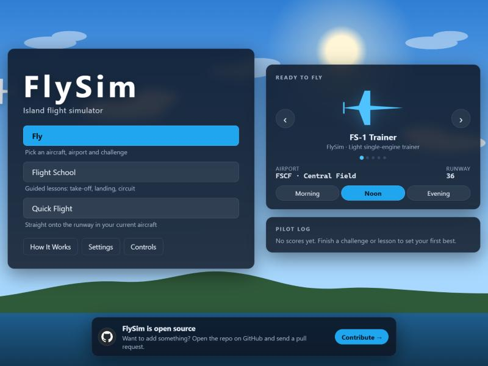

<div align="center">

# ✈️ FlySim

**An open-source island flight simulator that runs in your browser.**

Take off, fly a circuit and grease the landing, from a light trainer to an A350.

[](LICENSE)
[](CONTRIBUTING.md)
[](https://react.dev)
[](https://threejs.org)
[](https://www.typescriptlang.org)



</div>

## Features

- **Flight physics:** lift, drag, thrust and ground handling for each aircraft, including landing on open ground
- **Five aircraft:** FS-1 Trainer, Airbus A220, Airbus A350, Bombardier Global 8000 and F-22, each tuned against published figures
- **Airports and maps:** airports with more than one runway, a minimap and a full world map
- **Autopilot:** speed, heading, altitude and vertical-speed holds
- **Landing assist** (press `0` near a runway): flies the approach and the 3° glide path down to 100 ft, then hands over for the flare, and goes around if the approach is unstable
- **Landing coach:** tips during the approach, and every touchdown is graded
- **Flight School:** guided take-off, landing and full-circuit lessons
- **Challenges:** take-off, landing and ring courses, with best scores kept in your pilot log
- **Time of day:** morning, noon or evening light
- **Multiplayer:** share a room code and fly the island together, with mid-air collisions and an airborne-time leaderboard

## Quick start

You need [Node.js](https://nodejs.org) 22 or newer.

```bash
git clone https://github.com/SingeyDorje21/flysim.git
cd flysim
npm install
npm run dev
```

Then open the local URL Vite prints (usually http://localhost:5173).

## Controls

| Action                         | Keys                                     |
| ------------------------------ | ---------------------------------------- |
| Pitch down / up                | `W` / `S` or `↑` / `↓`                   |
| Roll left / right              | `A` / `D` or `←` / `→`                   |
| Yaw (rudder)                   | `Q` / `E`                                |
| Throttle up / down             | `R` / `F`, `+` / `-`, or `PgUp` / `PgDn` |
| Flaps down / up                | `X` / `Z` or `]` / `[`                   |
| Trim up / down                 | `.` / `,`                                |
| Brakes                         | `B` or `Space`                           |
| Landing gear                   | `G`                                      |
| Speed brake                    | `V`                                      |
| Reverse thrust                 | `Y`                                      |
| Landing assist                 | `0`                                      |
| Camera: chase / cockpit / free | `1` / `2` / `3` (`C` cycles)             |
| Toggle HUD / instruments       | `H` / `I`                                |
| World map                      | `M`                                      |
| Multiplayer leaderboard        | `L` (in a room)                          |
| Pause                          | `Esc` or `P`                             |

The full list is also on the **Controls** screen in the game.

## Multiplayer

Single player is unchanged and needs no server. Multiplayer adds a small server ([server/](server/)) that the browser connects to over WebSockets. Everyone online flies in the same sky.

**How it plays**

- **Join:** choose **Multiplayer** on the main menu. Enter a pilot name, pick an aircraft, then pick an airport and runway on the map. **Join the sky** puts you in the middle of that runway. Aircraft that need more than half of it for take-off (the airliners and business jet, and the F-22 on short runways) start further back, with their minimum runway still ahead. There are no rooms or codes: everyone online shares one world, up to 24 pilots.
- **Score:** your score is flying time × a multiplier. The multiplier starts at ×1.0, and the server grades every take-off and landing:
  - **Take-offs:** a clean take-off (wings level, no over-rotation) adds up to +0.25 once you've been airborne 10 s.
  - **Landings:** after a flight of at least 30 s, a soft landing adds up to +0.5. Under 1 m/s sink is a "Butter landing"; a hard one costs 0.25.
  - **Limits:** the multiplier stays between ×0.5 and ×5.
  - **Display:** your score, multiplier and latest grade show under the airspeed box.
- **Crashes and collisions:** any crash resets your score and multiplier to zero. If two aircraft touch, both crash and both reset. The server decides, using a sphere around each aircraft scaled to its size. You get 3 seconds of immunity after joining or respawning, and two aircraft that are both on the ground never collide. After a crash, **Respawn** puts you back mid-runway at your airport.
- **Scoreboard:** hold `Tab` to see everyone online, ranked by score, with their aircraft, multiplier and flying time.

**Run it locally**

Start the room server in one terminal and the game in another:

```bash
npm run server
```

```bash
npm run dev
```

On `localhost` the game finds the server at `ws://localhost:8787` by itself. To try two pilots, open the game in two browser windows and join from both.

**Deploy**

The site stays a static build on Vercel. Vercel can't host the always-on WebSocket server, so that runs on [Render](https://render.com), whose free plan works without a card. [`render.yaml`](render.yaml) sets it all up.

1. In Render: **New → Blueprint**, then pick this repository and branch. Render creates the `flysim-rooms` service and runs `npm run server`. Health checks hit `/healthz`.
2. That's it. The game connects to `wss://flysim-rooms.onrender.com` by default. If Render gives the service a different URL, set `VITE_MP_SERVER_URL` to it in Vercel and redeploy.

On the free plan the server sleeps after about 15 minutes idle. The first join after that takes up to a minute to connect, and the lobby says so while it waits.

| Setting                    | Where       | Meaning                                                                        |
| -------------------------- | ----------- | ------------------------------------------------------------------------------ |
| `VITE_MP_SERVER_URL`       | site build  | Multiplayer server URL. Default: `wss://flysim-rooms.onrender.com`, or `ws://localhost:8787` when the game runs on localhost |
| `PORT`                     | server      | Listen port (default `8787`)                                                   |
| `ALLOWED_ORIGINS`          | server      | Comma-separated site origins allowed to connect. `*` matches part of a host name, e.g. `https://flysim-*-singeys-projects.vercel.app` for every preview |
| `TRUST_PROXY`              | server      | `1` behind a proxy, so per-IP rate limits use `X-Forwarded-For`               |

**Decisions you might revisit:** these are in [docs/adr/0002-single-shared-sky.md](docs/adr/0002-single-shared-sky.md), which updates [ADR 0001](docs/adr/0001-multiplayer-room-server.md).
- The take-off and landing grades and the multiplier limits (in [server/scoring.ts](server/scoring.ts)).
- The score lives only as long as the server process. A free-tier sleep or a redeploy clears it.
- One sky holds 24 pilots.
- Mid-runway spawns are multiplayer only. Single-player modes still line up at the runway end.
- Heavier aircraft start back from the middle so their minimum runway is ahead. Where the whole runway is shorter than that, they line up at the end as in single player, and the lobby warns as it does there.

## Scripts

| Command             | What it does                        |
| ------------------- | ----------------------------------- |
| `npm run dev`       | Start the dev server                |
| `npm run server`    | Start the multiplayer room server   |
| `npm run build`     | Type-check and build for production |
| `npm run preview`   | Serve the production build          |
| `npm test`          | Run the tests (Vitest)              |
| `npm run typecheck` | Type-check without building         |
| `npm run lint`      | Lint with ESLint                    |

## Project layout

```
src/
├── simulation/   Flight physics (forces, engines, ground contact)
├── config/       Aircraft, airports and world settings
├── autopilot/    Autopilot holds and the landing assist
├── game/         Modes, lessons, challenges, scoring and the landing coach
├── world/        Three.js scene: terrain, airports, aircraft, camera
├── components/   React UI: menus, HUD, instruments, maps
├── input/        Keyboard controls and hotkeys
├── audio/        Engine sound and callouts
├── session/      Flight session lifecycle
├── net/          Multiplayer protocol, client and remote-pose smoothing
└── state/        Zustand stores
server/           Multiplayer room server (Node + ws)
```

## Contributing

Contributions are welcome: new aircraft, airports, lessons, bug fixes or better physics.

1. Fork the repo and create a branch: `git checkout -b feature/my-idea`
2. Make your change and add tests where it makes sense
3. Run the checks: `npm run typecheck`, `npm run lint` and `npm test`
4. Open a pull request describing what you changed and why

See [CONTRIBUTING.md](CONTRIBUTING.md) for more detail. Found a bug or have an idea? [Open an issue](https://github.com/SingeyDorje21/flysim/issues).

## Tech stack

[React 19](https://react.dev) · [Three.js](https://threejs.org) · [@react-three/fiber](https://r3f.docs.pmnd.rs) · [Zustand](https://zustand.docs.pmnd.rs) · [Vite](https://vite.dev) · [Vitest](https://vitest.dev) · TypeScript

## License

[MIT](LICENSE) © Singey Dorje
